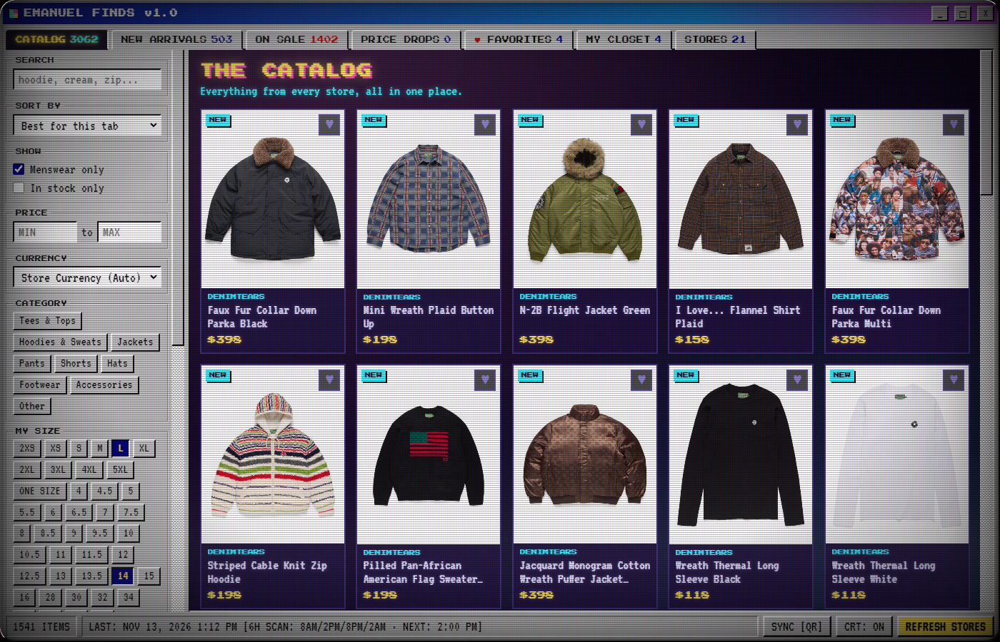
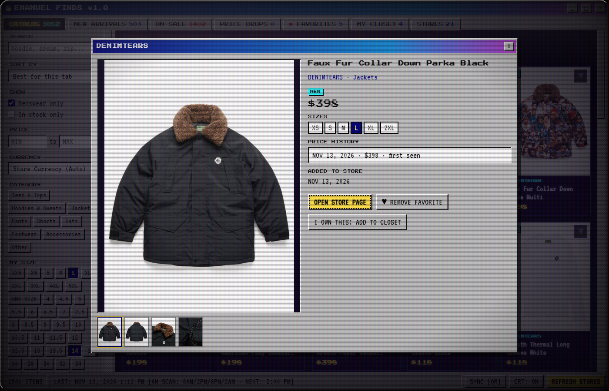
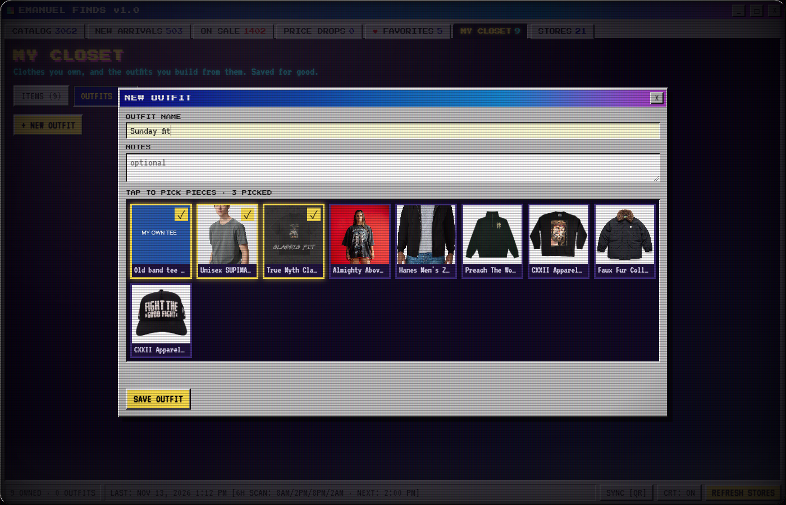
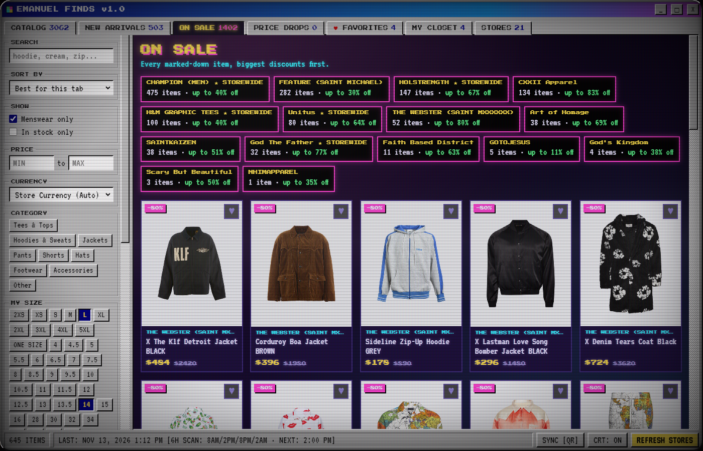
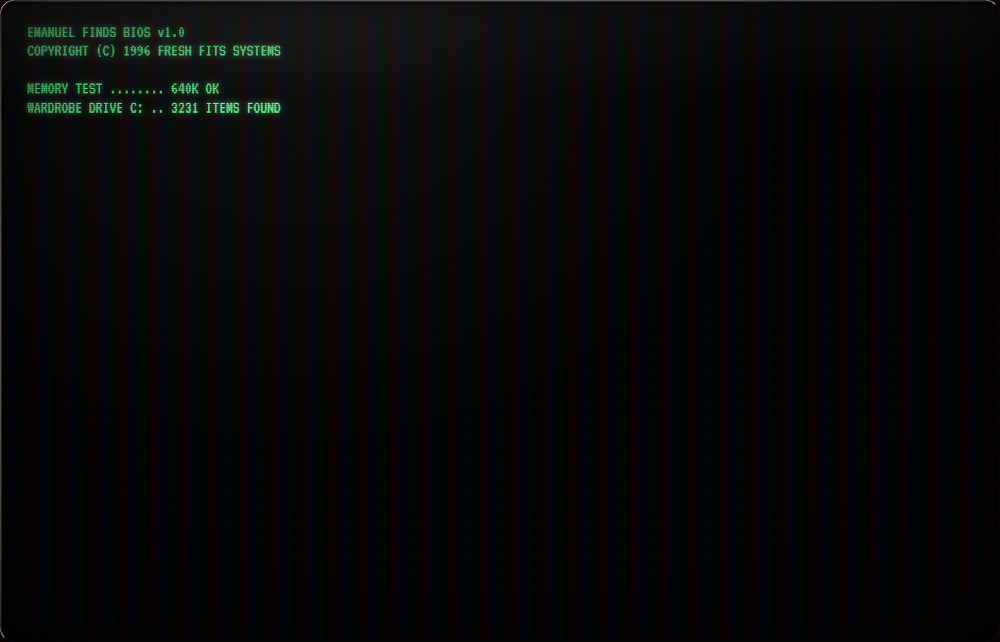

# Emanuel Finds

> **A retro CRT desktop & mobile aggregator for streetwear, archival drops, and vintage grails.**

Built with an authentic Windows 95 / CRT cyberpunk aesthetic, **Emanuel Finds** monitors your favorite independent fashion houses, stockists, and retail brands across the web. It pulls drops into a single unified grid, tracks markdowns and restocks on an automated cycle, saves photos locally for offline browsing, and cross-syncs with your phone over your local network—zero cloud accounts, zero ads, and zero algorithmic feeds.

---

## Screenshots

<div align="center">
  
  <p><em>The unified catalog: filtering multi-store inventory with real-time price conversion and size filtering.</em></p>
</div>

<br>

| Product Detail & Photo Inspector | My Closet & Outfit Canvas |
|:---:|:---:|
|  |  |

<br>

| On Sale & Storewide Discount Tracker | BIOS Boot Sequence |
|:---:|:---:|
|  |  |

---

## Key Features

- **Unified Multi-Store Catalog**: Aggregates apparel, hoodies, tees, outerwear, and accessories from diverse stockists (Shopify public JSON collections, Next.js PLP endpoints, and custom scrapers) into one unified searchable library.
- **Automated Price Drop & Restock Radar**: Background scanner scheduled every 6 hours (8:00 AM, 2:00 PM, 8:00 PM, 2:00 AM) that compares historical pricing and variant stock to alert you on wishlist drops or surprise restocks.
- **Offline-First Photo Caching**: Downloaded product images and metadata are stored locally in an in-memory SHA-1 cache. You can browse your entire catalog on a plane, subway, or without an active internet connection.
- **Virtual DOM Acceleration**: Engineered with CSS `content-visibility: auto`, sub-millisecond layer compositing, and prefetching intersection observers for smooth 60fps/120fps scrolling across 3,000+ items.
- **My Closet & Outfit Builder**: Log pieces you already own (custom photo uploads or import directly from web drops) and build 2-piece, 3-piece, or 4-piece outfit collages to plan your rotation.
- **Private LAN QR Cross-Sync**: Sync your wishlist, closet items, outfits, and store settings between your desktop and Android phone instantly over local Wi-Fi. No external servers or third-party databases.
- **Configurable Aesthetics**: Toggle retro CRT scanlines, RGB phosphors, and tube curvature, or run clean flat Win95 chrome.

---

## Tech Stack

- **Desktop**: [Electron](https://www.electronjs.org/) + Vanilla JavaScript (ES6+), custom `cfimg://` protocol caching, Win32 frameless window controls.
- **Mobile**: [Capacitor](https://capacitorjs.com/) + Android Studio native shell with camera QR scanner and local push notifications.
- **Storage**: Local JSON database (`catalogue.json`), SHA-1 hashed offline image store, and base64 closet file system.
- **Networking**: Electron `net.fetch` engine with automatic store rate-limiting and leaf signature verification.

---

## Quickstart

### Prerequisites
- [Node.js](https://nodejs.org/) (v18 or newer)
- npm

### 1. Clone & Install
```bash
git clone https://github.com/EmanuelMakesThings/emanuel-finds.git
cd emanuel-finds
npm install
```

### 2. Run Desktop App
```bash
npm start
```
Hit **Refresh Stores** on first launch to populate the local catalogue with live inventory.

### 3. Build Portable Windows Binary
```bash
npm run dist
```
Outputs a standalone `Emanuel-Finds.exe` in `dist/`.

### 4. Android Phone Build (Optional)
```bash
cd mobile
npm install
npm run apk
```
Open `mobile/android` in Android Studio or deploy via `adb install` to run on any Android device.

---

## Adding Custom Stores

To add an extra store directly inside the app:
1. Open the **STORES** tab.
2. Enter the shop's domain (e.g. `kith.com` or `shop.brandname.com`).
3. If it runs on a standard public collection structure, Emanuel Finds automatically detects categories, variants, and product images.

---

## Legal & Nominative Fair Use Disclaimer

- **Unofficial Personal Tool**: *Emanuel Finds* is an open-source, non-commercial hobbyist application created strictly for personal cataloging, price tracking, and educational purposes.
- **Trademark Notice**: All product names, logos, brand names, and store trademarks displayed or referenced within the application are the property of their respective trademark holders. Use of these names does not imply any affiliation with, endorsement by, or sponsorship by any brand or retailer.
- **Public Data Only**: This software accesses only publicly accessible, unauthenticated endpoints. Users are responsible for complying with the terms of service of any external websites they query.

---

## License

Distributed under the [MIT License](LICENSE).
