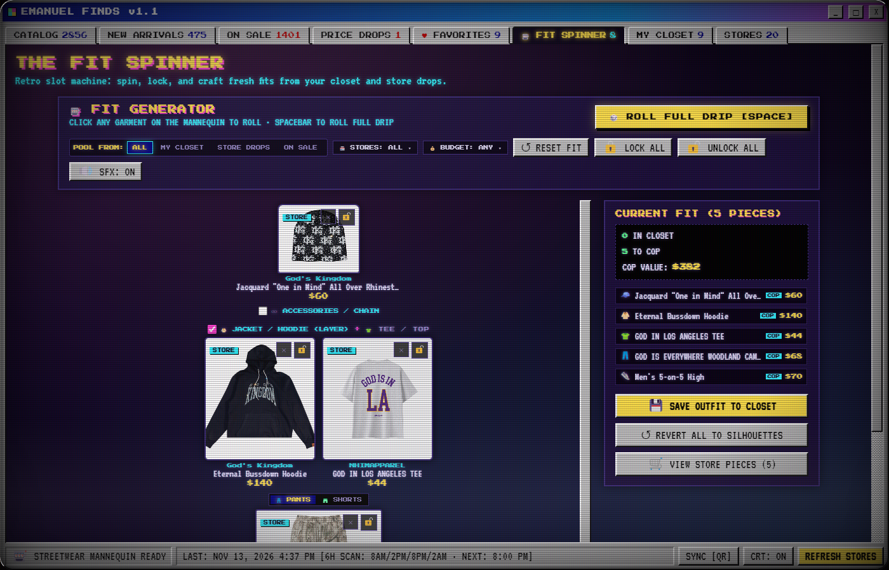
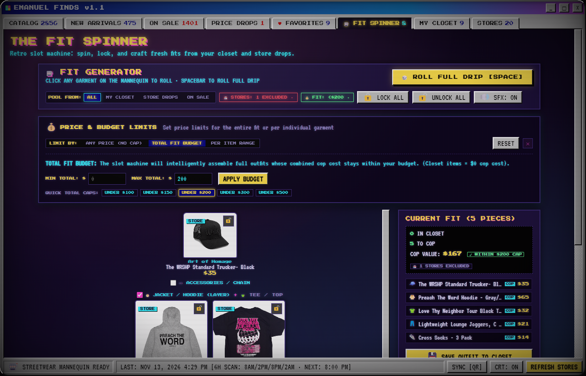
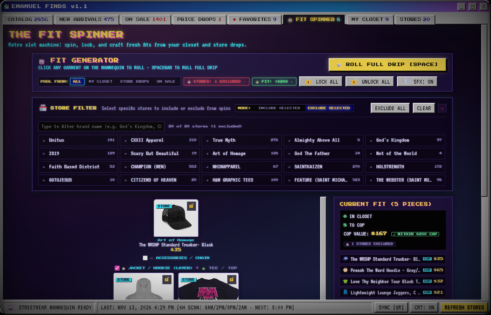

# Emanuel Finds

> **A retro CRT desktop & mobile aggregator, wardrobe vault, and streetwear mannequin fit engine.**

[](https://github.com/EmanuelMakesThings/emanuel-finds/releases)
[](https://github.com/EmanuelMakesThings/emanuel-finds)
[](LICENSE)

Built with an authentic Windows 95 / CRT cyberpunk aesthetic, **Emanuel Finds** monitors your favorite independent fashion houses, Christian streetwear stockists, and retail brands across the web. It pulls drops into a single unified grid, tracks markdowns and restocks on an automated cycle, saves photos locally for offline browsing, and cross-syncs with your phone over your local network—zero cloud accounts, zero ads, and zero algorithmic feeds.

> **NEW IN v1.1: The Streetwear Mannequin & Fit Engine Update** — Spin, layer, curate, and budget full head-to-toe fits with upper-body jacket + tee layering, brand inclusion/exclusion filters, and an automated Monte-Carlo budget solver.

---

## Highlights in v1.1: The Fit Spinner

<div align="center">
  
  <p><em>The v1.1 Fit Spinner: anatomical streetwear mannequin with dual jacket + tee torso layering, eye-friendly cyber segmented pills, and smart budget solver.</em></p>
</div>

<br>

| 💰 Smart Budget & Price Solver | 🏪 Store Inclusion & Exclusion Engine |
|:---:|:---:|
|  |  |
| *Set full fit budgets ($100, $150, $200) or per-item brackets.* | *Include specific brands or exclude high-ticket luxury archives.* |

---

## Desktop & Mobile Gallery

<div align="center">
  
  <p><em>The unified catalog: filtering multi-store inventory with real-time price conversion and size filtering.</em></p>
</div>

<br>

| Product Detail & Photo Inspector | My Closet & Wardrobe Vault |
|:---:|:---:|
|  |  |

<br>

| On Sale & Storewide Discount Tracker | BIOS Boot Sequence |
|:---:|:---:|
|  |  |

---

## Key Features

- **🎰 Interactive Streetwear Mannequin (The Fit Spinner)**:
  - **Head-to-Toe Anatomy**: Anatomically proportioned interactive cards (Headwear, Accessories/Chain, Jacket/Hoodie, Tee/Top, Pants/Shorts, Kicks).
  - **Upper-Body Torso Layering**: Wear and spin both a Jacket/Hoodie **AND** a Tee simultaneously with realistic broad-shoulder proportions, plus a 1-click toggle for warm-weather fits.
  - **🏪 Store Curation (Include/Exclude)**: Filter exactly which shops items are pulled from. Choose `INCLUDE SELECTED` to roll from only your favorite 2-3 brands, or `EXCLUDE SELECTED` to filter out luxury archive stores.
  - **💰 Automated Budget Solver**: Set a total outfit budget (e.g., `Max: $200`) or per-item price brackets (e.g., `Under $50/piece`). The engine evaluates combinations across the catalogue to assemble outfits guaranteed to stay within your spending cap.
  - **🕶️ Eye-Friendly Dark Controls**: Replaced native OS dropdowns with dark CRT segmented cyber buttons (`[ALL] [MY CLOSET] [STORE DROPS] [ON SALE]`) to eliminate white flashes.
  - **Audio FX**: Authentic synthesized ratchet reel ticks and winning jackpot chimes via the Web Audio API.
- **Unified Multi-Store Catalog**: Aggregates apparel, hoodies, tees, outerwear, and accessories from diverse stockists (Shopify public JSON collections, Next.js PLP endpoints, and custom scrapers) into one unified searchable library.
- **Automated Price Drop & Restock Radar**: Background scanner scheduled every 6 hours (8:00 AM, 2:00 PM, 8:00 PM, 2:00 AM) that compares historical pricing and variant stock to alert you on wishlist drops or surprise restocks.
- **Offline-First Photo Caching**: Downloaded product images and metadata are stored locally in an in-memory SHA-1 cache. You can browse your entire catalog on a plane, subway, or without an active internet connection.
- **Virtual DOM Acceleration**: Engineered with CSS `content-visibility: auto`, sub-millisecond layer compositing, and prefetching intersection observers for smooth 60fps/120fps scrolling across 3,000+ items.
- **My Closet & Outfit Builder**: Log pieces you already own (custom photo uploads or import directly from web drops) and build 2-piece, 3-piece, or 4-piece outfit collages to plan your rotation.
- **Private LAN QR Cross-Sync**: Sync your wishlist, closet items, outfits, and store settings between your desktop and Android phone instantly over local Wi-Fi. No external servers or third-party databases.
- **Configurable Aesthetics**: Toggle retro CRT scanlines, RGB phosphors, and tube curvature, or run clean flat Win95 chrome.

---

## Tech Stack

- **Desktop**: [Electron](https://www.electronjs.org/) + Vanilla JavaScript (ES6+), custom `cfimg://` protocol caching, Win32 frameless window controls.
- **Mobile**: [Capacitor](https://capacitorjs.com/) + Android Studio native shell with camera QR scanner and local push notifications.
- **Storage**: Local JSON database (`catalogue.json`), SHA-1 hashed offline image store, and base64 closet file system.
- **Networking**: Electron `net.fetch` engine with automatic store rate-limiting and leaf signature verification.

---

## Quickstart

### Prerequisites
- [Node.js](https://nodejs.org/) (v18 or newer)
- npm

### 1. Clone & Install
```bash
git clone https://github.com/EmanuelMakesThings/emanuel-finds.git
cd emanuel-finds
npm install
```

### 2. Run Desktop App
```bash
npm start
```
Hit **Refresh Stores** on first launch to populate the local catalogue with live inventory.

### 3. Build Portable Windows Binary
```bash
npm run dist
```
Outputs a standalone `Emanuel-Finds.exe` in `dist/`.

### 4. Android Phone Build (Optional)
```bash
cd mobile
npm install
npm run apk
```
Open `mobile/android` in Android Studio or deploy via `adb install` to run on any Android device.

---

## Adding Custom Stores

To add an extra store directly inside the app:
1. Open the **STORES** tab.
2. Enter the shop's domain (e.g. `kith.com` or `shop.brandname.com`).
3. If it runs on a standard public collection structure, Emanuel Finds automatically detects categories, variants, and product images.

---

## Legal & Nominative Fair Use Disclaimer

- **Unofficial Personal Tool**: *Emanuel Finds* is an open-source, non-commercial hobbyist application created strictly for personal cataloging, price tracking, and educational purposes.
- **Trademark Notice**: All product names, logos, brand names, and store trademarks displayed or referenced within the application are the property of their respective trademark holders. Use of these names does not imply any affiliation with, endorsement by, or sponsorship by any brand or retailer.
- **Public Data Only**: This software accesses only publicly accessible, unauthenticated endpoints. Users are responsible for complying with the terms of service of any external websites they query.

---

## License

Distributed under the [MIT License](LICENSE).
